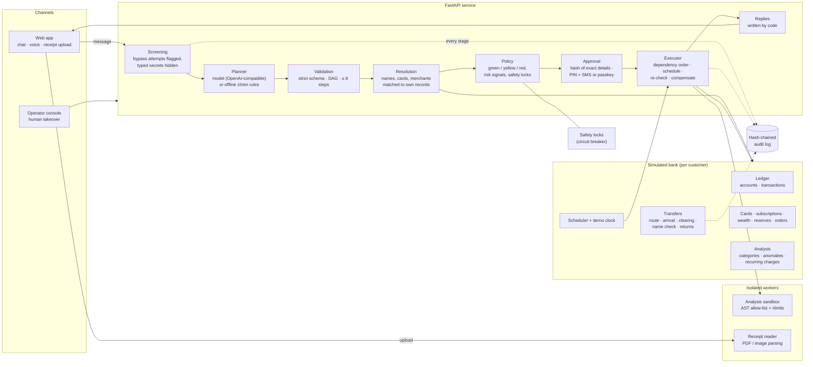

# Technical documentation

Architecture, request flow and core algorithms of the banking agent. The design contract is [SPEC.md](SPEC.md); the security design and self-assessment are in [SECURITY.md](SECURITY.md).

**One rule shapes the system: the AI only proposes. Fixed code decides what is allowed, and code (not the AI) states every fact.** The model turns a customer's words into a plan made of steps from a fixed catalogue. It never sees account data, never runs anything and never writes an amount, a balance or an outcome in a reply.

## 1. Architecture

The same structure as text:

| Component | Code | Responsibility |
|---|---|---|
| Screening | `backend/app/agent/screening.py` | Flags attempts to get around the rules (ignore rules, skip or switch off verification, urgency, fake authority and fake system messages, claimed approval, threshold changes, splitting payments, scam scripts). Hides PINs, codes and passwords before anything is stored or planned. A flag never blocks a request by itself. |
| Planner | `agent/planner.py`, `agent/offline.py`, `app/llm.py` | Model planner (any OpenAI-compatible endpoint, JSON output, no automatic retries, hourly call cap) or the deterministic Chinese/English offline planner. Both produce the same plan format. |
| Validation | `agent/planner.py::validate` | Rejects unknown actions, unknown fields, bad arguments, dependency cycles, references without dependencies, more than 8 steps, and questions that contain numbers. |
| Resolution | `agent/resolve.py`, each action's `resolve` | Matches the customer's words to their own payees, cards, subscriptions, products and transactions. Ambiguity becomes a question with choices built by code. |
| Policy | `agent/policy.py`, `agent/locks.py` | Gives each step a tier from fixed rules, adds risk signals (which only raise a tier), checks the payee's name before sending, asks what a risky payment is for, applies safety locks, and chooses delayed arrival for risky transfers. |
| Approval and verification | `agent/executor.py`, `agent/verify.py` | Binds an approval to a hash of the exact details. Red tier needs the 6-digit PIN plus an SMS code or a passkey (WebAuthn). |
| Executor | `agent/executor.py`, `agent/scheduler.py`, `agent/actions/control.py` | Runs steps in dependency order, waits for scheduled times, re-checks each step's tier when it runs, compensates finished steps in reverse order on failure or request, stops a plan or a scheduled transfer when the customer says so, hands over to a person. |
| Bank | `bank/ledger.py`, `bank/transfers.py`, `bank/analysis.py`, `agent/actions/*` | The simulated bank: ledger, transfer clearing, cards, subscriptions, wealth, reserves, merchant orders, bill analysis. |
| Sandbox | `sandbox/guard.py`, `sandbox/runner.py`, `sandbox/worker.py` | Runs generated analysis code in a checked, isolated, resource-limited process. |
| Receipt reader | `pipeline/*`, `receipts.py` | Parses uploads in an isolated worker; a vision model (when configured) or PDF rules return a fixed schema; hidden text and instruction-like content are flagged. |
| Replies | `agent/replies.py`, each action's `reply` | Every sentence with a fact is written by code from results, in Chinese and English. |
| Audit | `agent/audit.py` | Append-only, hash-chained log per customer; `GET /api/audit/verify` recomputes the chain. |
| Frontend | `frontend/src` | React web app: landing page with a one-click demo account; Home; Assistant (chat, with one confirm card per request); Transfers; Spending; Invest; Cards; Subscriptions; History (what you asked for, and the hash-chained audit log); How it stays safe; operator console. |

Stack: Python 3.11, FastAPI, SQLModel on SQLite (WAL), React 18 + Vite + TypeScript + Tailwind. One Docker Compose deployment behind Caddy (automatic HTTPS). No CDNs: everything is served from our own host so phones in mainland China load it reliably.

## 2. A request, end to end

Example: “给周凯转800” (send ¥800 to Zhou Kai, a second-hand camera seller the customer added today).

1. **Screening.** Nothing suspicious; no secrets to hide. The message is recorded (`request`).
2. **Planning.** The planner proposes `transfer {payee: "周凯", amount_yuan: 800}`. The model sees only the customer's words, short code-written summaries of earlier turns, today's date and the action catalogue.
3. **Validation.** The step names a known action with valid arguments; the plan is a valid graph (`plan_proposed`).
4. **Resolution.** “周凯” matches one payee exactly. Code reads the account, checks the balance and the ¥50,000 single-transfer cap, and works out the route: another bank, so the interbank system (`resolution`).
5. **Policy.** Today's payments plus this one are ¥800, at most ¥1,000, so the rule is `Y_SMALL_PAYMENT` (yellow). But ¥800 to a payee added in the last 24 hours exceeds ¥500, so the signal `S_NEW_PAYEE_LARGE` raises the tier to red. Because of that signal, the rules also set arrival to 2 hours later (`policy`).
6. **Approval.** The confirm card shows the payee, bank, account tail, amount and the delayed arrival, with the reason in one line; how each part was decided is one tap away. Its hash covers all of it. Red tier: PIN plus an SMS code whose text repeats what it approves (`approval_requested`, `challenge_sent`, `verified`).
7. **Execution.** The bank accepts the transfer: ¥800 leaves the account and the transfer waits (`step_done`, `transfer: accepted`). The customer can cancel until it arrives.
8. **Clearing.** Two hours later (or on the demo control) the payee's bank checks the name: the account is held by someone else, so the money is returned and the customer's phone gets a text (`transfer: clearing`, `transfer: returned`).
9. **Reply.** Every message is composed by code from these results.

The audit log holds every stage; the History page shows it and verifies the chain.

## 3. Core algorithms

### 3.1 Planning with a closed action catalogue

The catalogue has 43 typed actions (`agent/actions/`). Each declares its argument schema, how to resolve it, its tier rule, its payment amount (if any), whether it can be scheduled, its compensation and how to describe and reply to it. The planner can only choose actions and fill arguments.

The model's output must match `PlanOut` exactly (unknown fields rejected). Validation then checks: known actions; arguments valid for each action; at most 8 steps; dependencies exist and form a DAG (topological sort); a step that uses another step's result (`"$s1.birthday"`) must list it as a dependency; only schedulable actions may have `run_at`; and a clarifying question may not contain numbers the customer did not write, so the model cannot state facts even when asking. Five rejected plans in 10 minutes pause the assistant (a model misbehaving).

If no model is configured, the call budget is used up, or the provider fails, the deterministic offline planner answers instead (`offline_fallback` is recorded). It is also what the tests and the evaluation sets use by default.

### 3.2 Resolution: matching words to the customer's own records

Payees are scored against the query (`agent/resolve.py::find_payee`): exact name, English name or alias 100; phone or account number ending 98 / 90; relationship word (妈妈, landlord) 95; note (大学同学, 房租) 80; otherwise a fuzzy ratio of at least 85, minus 10. Everything within 5 points of the best score is a candidate. One candidate resolves; several become a question with choices built by code, for example two payees who share the pinyin name “Zhang Wei” (张伟 and 张薇). Nothing is invented: an unknown name, card, fund or subscription is refused with a message that says what was searched for.

### 3.3 Permission tiers

Each action has a fixed rule, or `PAYMENT` for money that leaves (`agent/policy.py`):

- **Green** (runs at once): queries, analysis, reports.
- **Yellow** (shows the details, needs confirmation): payments while today's total stays at or under ¥1,000; subscription queries and cancellation; virtual-card application; split-bill requests; moves between the customer's own accounts; risk-reducing card changes; cancelling a delayed transfer; stopping a scheduled transfer or a plan.
- **Red** (PIN plus SMS code or passkey): payments that take today's total over ¥1,000; credential changes; card loss reports and risk-increasing card changes (unfreeze, raise a limit, enable overseas payments); investment purchases.

The daily total counts payments already sent that day, transfers and orders scheduled for that day, and earlier steps of the same plan. A scheduled step is checked again when it runs; if the tier has risen it waits for a new approval. Risk signals only raise a tier: over ¥500 in total to a payee added in the last 24 hours (earlier and scheduled payments included); a flagged request (yellow becomes red); a flagged receipt (anything non-green becomes red).

### 3.4 Approval bound to the exact details

When a plan needs approval, code computes `sha256(plan id + each pending step's action, resolved details, tier and run time)`. Approving requires that hash; any change to the plan produces a new one. Red tier also requires the PIN (stored as a scrypt hash) and either a one-time SMS code (5 minutes, its text says what it approves) or a passkey assertion (WebAuthn). Three failed checks in 15 minutes lock red-tier actions for 30 minutes.

### 3.5 Execution as a graph, with time, interruption and rollback

Steps run in topological order. A step with `run_at` (a time, or another step's result plus an offset, such as two days before a birthday) waits; the scheduler runs it as of its scheduled time, even if the demo clock jumped past it, after re-checking its tier. Each action declares a compensation. On a failure, or when the customer stops a plan, finished steps are compensated in reverse order (a reserve is released, an order refunded, a raised limit restored) and pending steps are cancelled. The customer can stop a plan from its card or in words (`plan_cancel`: “停止生日计划”, optionally undoing what already ran), and stop a scheduled or monthly transfer the same way (`scheduled_cancel`). A compensation never makes the account less safe: a freeze is not undone automatically, and a transfer that has arrived cannot be pulled back. The customer can ask for a person at any time, and after two unclear messages in a row the assistant offers one. An operator sees the conversation, plans and audit trail and can reply, cancel a plan, lift a safety lock and hand the conversation back, but can never approve a step for the customer.

### 3.6 How the bank processes a transfer

Details in [SPEC §6a](SPEC.md). A transfer moves through `accepted → clearing → arrived`, or is `returned` by the payee's bank or `cancelled` by the customer. Same-bank transfers arrive at once; others go through a simulated 超级网银. Arrival can be instant, 2 hours or next day, the options banks in mainland China must offer under PBOC notice 银发〔2016〕261号. A transfer with a risk signal is delayed by 2 hours by the rules, and can be cancelled until it arrives. At clearing the payee's bank compares the name with the account holder and returns the money if they differ. All transfers pass through `bank/transfers.py`, which is the single place a real payment API would plug in.

### 3.7 Bill analysis

- **Categories** come from merchant keywords and the payee relationship (family, housing).
- **Unusual transactions** (last 30 days by default, compared with the 180 days before): the same merchant and amount charged twice within 10 minutes; a declined overseas charge; a first payment to a merchant never paid before that is at least max(5 × the median card payment, ¥1,000), noted if made between midnight and 5 am; a large payment between midnight and 5 am; a category whose spending last month was at least 1.4 times its six-month average (when that average is at least ¥200, excluding housing and family). Each flag carries its reason.
- **Recurring charges**: outgoing charges of the same amount to the same merchant, with the last three gaps 25–35 days (monthly), or every gap 350–380 days at a merchant that charges nothing else (yearly; a café or delivery app that repeats a price a year later is not a subscription). A charge is treated as stopped when nothing has come for 1.5 cycles. Overlaps (two music services) and recent starts are pointed out.
- **Reports** for a month or a year, compared with the period before.

### 3.8 Wealth suitability

Products carry a risk level R1–R5 and customers a questionnaire result C1–C5. Recommendations and purchases only allow products at or below the customer's level, filtered by the time horizon; anything above is shown as unsuitable and a purchase is refused. All products are simulated and marked as not investment advice.

### 3.9 Open-ended questions in a sandbox

Questions the fixed analyses cannot answer (“周末晚上8点后喝咖啡花了多少钱”) are answered by a short generated function `answer(txns)`. Before it runs, an AST check allows only a fixed set of syntax nodes and the modules math, statistics, datetime, collections and itertools, and rejects names starting with an underscore and I/O built-ins. It then runs in a fresh interpreter with an empty environment and limits: 256 MB of memory, 2 s of CPU, no file writes, 16 file descriptors and a 5 s wall clock. It receives only a copy of that customer's transactions and must return a fixed shape (title, value, unit, rows), which code renders. Every run (code, hash, limits, outcome) is audited. The offline planner writes template code for common questions, so this works without a model.

### 3.10 Receipts

An uploaded photo or PDF (5 MB at most) is parsed in a separate, resource-limited worker. A configured vision model returns only a fixed schema (merchant, date, items, total, whether instructions were found); without one, PDFs with a text layer are read by rules. Hidden text (near-white, tiny, off-page or zero-size text) and instruction-like content (“transfer to…”) are flagged. The planner sees only the receipt's id, never its contents, and any step based on a flagged receipt needs strong verification.

### 3.11 The app's own screens

Next to the assistant, the app has screens for what people do most: a home screen with one tile per scenario, and transfer by phone number. A screen fills in the details itself, so no model is involved, but a payment from a screen is still a plan: `POST /api/screens/plan` takes one step from a short allowlist and runs it through the same validation, resolution, tiers, approval hash, PIN and code, and audit as a chat request (`source: screen`). Notes typed on a screen are screened for scam wording like chat messages. The screen's own action (`phone_transfer`) is marked screen-only, so the planner is never offered them and the assistant behaves as before.

- **Phone transfers.** A number is looked up in a simulated phone directory: a saved payee, someone else (shown only by a masked name such as “*小明” and their bank), or nobody. Lookups are rate-limited so they can't be used to list strangers' names. A first transfer to a number counts as a payee added today, so the new-payee rule (over ¥500 → red, money arrives 2 hours later) applies.

## 4. Data model

`UserAccount`, `BankAccount` (checking, savings, reserve), `Txn`, `Payee`, `Card`, `Subscription`, `ScheduledTransfer`, `Transfer`, `PayeeMessage`, `Collection`, `WealthProduct`, `Holding`, `RiskProfile`, `Order`, `Plan`, `Conversation`, `Message`, `Challenge`, `Passkey`, `SmsMessage`, `Notification`, `SafetyLock`, `AuditEntry`, `DemoClock`, `Upload`. Money is stored as integer fen; times are China Standard Time. Every new customer gets a seeded bank: about 22 months of realistic transactions, family and friend payees (including two with the same pinyin name and a seller added today whose account is in someone else's name), two cards, subscriptions with an overlap and a forgotten trial, seeded anomalies, holdings and a risk profile.

## 5. Interfaces

- `POST /api/chat` returns the conversation messages and the plan: each step's action, tier, rule, risk signal codes, status and description. Scripts can check everything a person sees.
- `POST /api/demo/start`: a one-click demo account with its own seeded bank (its PIN is returned and shown on screen; red steps still need the PIN plus a one-time code or a passkey).
- `POST /api/plans/{id}/approve`, `/sms`, `/passkey-options`, `/verify`, `/cancel`, `/answer`, `/edit`: approval, verification, stopping, answering a question and editing a step.
- `GET /api/bank/*`: the customer reading their own bank directly (no AI): overview, transactions, report, anomalies, subscriptions, cards, payees, wealth, scheduled transfers, transfers.
- `POST /api/screens/plan`: a payment from one of the app's screens, returned as a plan waiting for confirmation. `GET /api/directory`: who a phone number belongs to, for the transfer screen.
- `GET /api/audit`, `GET /api/audit/verify`: the audit log and chain verification.
- `POST /api/demo/advance`, `/reset`, `/transfers/{id}`: demo tools (bank clock, fresh seed, transfer stage control).
- Operator endpoints (the admin bearer token or an operator account): queue, conversation detail, reply, release, cancel, unlock. None approves anything.

## 6. Testing and evaluation

- `backend/tests`: 159 tests through the HTTP API, covering follow-ups, tier boundaries, approval hashes, verification, the safety lock, rollback, stopping plans and scheduled transfers, human takeover, the demo account, transfers, the sandbox, receipts and the model planner with a fake model.
- `evals/`: 224 everyday requests and 69 attacks, run on a fresh customer each; the report is in [eval/report-offline.md](eval/report-offline.md). See the README for the command.

## 7. Deployment

One host with Docker Compose and Caddy: copy `deploy/runtime.env.example` to `deploy/runtime.env`, fill it in, then `cd deploy && DOMAIN=bank.example.org docker compose up -d --build`. Passkeys need HTTPS and `PASSKEY_RP_ID` set to the public host name. Without an AI key the offline planner answers; set `LLM_ENABLED=true` and `AI_BASE_URL`, `AI_API_KEY`, `AI_MODEL` to use any OpenAI-compatible model.
