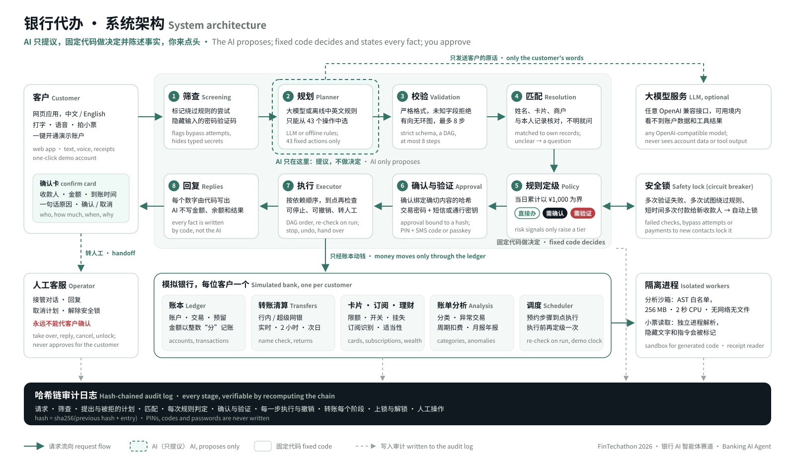
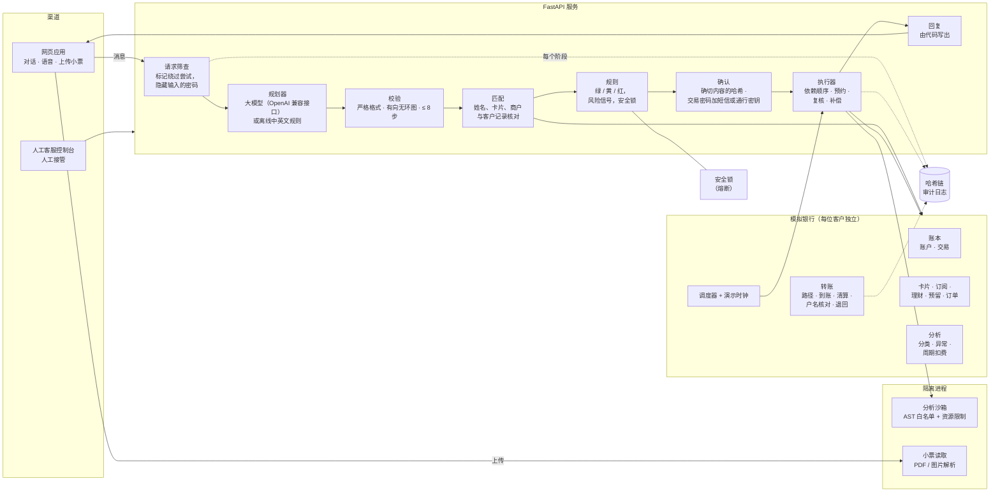

# 技术文档

银行智能体的系统架构、请求流程和核心算法。安全设计与自评见 [SECURITY.zh.md](SECURITY.zh.md)，设计约定见 [SPEC.md](SPEC.md)（英文）。英文版：[ARCHITECTURE.md](ARCHITECTURE.md)。

**整个系统遵循一条原则：AI 只提议，固定代码做决定，并由代码（而不是 AI）陈述每一个事实。** 模型把客户的话变成计划，计划中的步骤只能取自固定的操作目录。模型看不到账户数据，不执行任何操作，也不会在回复中写出金额、余额或结果。

## 一、系统架构

同一结构的文字版：

| 组件 | 代码 | 职责 |
|---|---|---|
| 请求筛查 | `backend/app/agent/screening.py` | 标记绕过规则的尝试（忽略规则、跳过或关闭验证、催促“来不及确认”、冒充权威和伪造系统消息、声称已确认、修改阈值、拆分付款、诈骗话术）；在存储或规划前隐藏交易密码、验证码和登录密码。标记本身不会拦截请求。 |
| 规划器 | `agent/planner.py`、`agent/offline.py`、`app/llm.py` | 模型规划器（任意 OpenAI 兼容接口，JSON 输出，不自动重试，每小时调用上限）或确定性的中英文离线规划器，两者输出相同格式的计划。 |
| 校验 | `agent/planner.py::validate` | 拒绝未知操作、未知字段、错误参数、循环依赖、未声明依赖的引用、超过 8 步的计划，以及含有数字的追问。 |
| 匹配 | `agent/resolve.py` 及各操作的 `resolve` | 把客户的话与其本人的收款人、卡片、订阅、产品和交易核对；有歧义时由代码生成带选项的追问。 |
| 规则 | `agent/policy.py`、`agent/locks.py` | 按固定规则给每个步骤定级，加上只升不降的风险信号，执行安全锁，并为有风险的转账选择延时到账。 |
| 确认与验证 | `agent/executor.py`、`agent/verify.py` | 确认绑定确切内容的哈希；红色操作需要 6 位交易密码加短信验证码或通行密钥（WebAuthn）。 |
| 执行器 | `agent/executor.py`、`agent/scheduler.py`、`agent/actions/control.py` | 按依赖顺序执行，等待预约时间，执行时重新检查等级，失败或客户要求时逆序补偿已完成的步骤，客户开口即可停止计划或预约转账，转人工。 |
| 银行 | `bank/ledger.py`、`bank/transfers.py`、`bank/analysis.py`、`agent/actions/*` | 模拟银行：账本、转账清算、卡片、订阅、理财、预留资金、商户订单、账单分析。 |
| 沙箱 | `sandbox/guard.py`、`sandbox/runner.py`、`sandbox/worker.py` | 在经过检查、相互隔离、受资源限制的进程中运行生成的分析代码。 |
| 小票读取 | `pipeline/*`、`receipts.py` | 在隔离进程中解析上传文件；视觉模型（如已配置）或 PDF 规则返回固定格式；标记隐藏文字和类似指令的内容。 |
| 回复 | `agent/replies.py` 及各操作的 `reply` | 每句包含事实的话都由代码根据结果写出，中英文双语。 |
| 审计 | `agent/audit.py` | 每位客户一条只追加、以哈希串联的日志；`GET /api/audit/verify` 重新计算整条链。 |
| 前端 | `frontend/src` | React 网页应用：首页（一键开通演示账户）；首页；助手（对话，每个请求一张确认卡）；转账；账单；理财；卡片；自动续费；记录（你办过的事和哈希链审计日志）；安全原理；人工客服控制台。 |

技术栈：Python 3.11、FastAPI、SQLModel + SQLite（WAL）、React 18 + Vite + TypeScript + Tailwind。用 Docker Compose 部署在 Caddy 之后（自动 HTTPS）。不使用任何 CDN：所有资源都由自己的服务器提供，确保中国大陆的手机能稳定加载。

## 二、一个请求的完整过程

示例：“给周凯转800”（向客户今天刚添加的二手相机卖家周凯转 ¥800）。

1. **筛查。** 没有可疑内容，没有需要隐藏的密码。记录请求（`request`）。
2. **规划。** 规划器提出 `transfer {payee: "周凯", amount_yuan: 800}`。模型只看到客户的原话、由代码写的前几轮简短摘要、今天的日期和操作目录。
3. **校验。** 步骤使用已知操作、参数有效，计划是有效的图（`plan_proposed`）。
4. **匹配。** “周凯”精确匹配到一位收款人。代码读取账户，检查余额和单笔 ¥50,000 上限，并确定路径：对方是他行，走跨行系统（`resolution`）。
5. **规则判定。** 当日付款加上这一笔共 ¥800，不超过 ¥1,000，规则为 `Y_SMALL_PAYMENT`（黄色）。但向 24 小时内新加的收款人付款 ¥800 超过 ¥500，风险信号 `S_NEW_PAYEE_LARGE` 把等级提高为红色。由于这个信号，规则同时把到账方式设为 2 小时后到账（`policy`）。
6. **确认。** 确认卡展示收款人、银行、账号尾号、金额和延时到账，并用一句话说明原因；每一项是怎么判定的，点开即可查看。哈希覆盖全部内容。红色等级：交易密码加短信验证码，短信写明它用于哪项操作（`approval_requested`、`challenge_sent`、`verified`）。
7. **执行。** 银行受理转账：¥800 从账户扣出，转账进入等待（`step_done`、`transfer: accepted`）。到账前客户可以撤销。
8. **清算。** 两小时后（或在演示中手动推进），对方银行核对户名：该账户属于另一个人，资金被退回，客户手机收到短信（`transfer: clearing`、`transfer: returned`）。
9. **回复。** 每条消息都由代码根据这些结果写出。

审计日志保存每个阶段；“记录”页面展示并校验整条链。

## 三、核心算法

### 3.1 封闭操作目录下的规划

操作目录共有 43 个带类型的操作（`agent/actions/`）。每个操作声明自己的参数格式、匹配方式、定级规则、付款金额（如有）、是否可预约、补偿方式，以及如何描述和回复。规划器只能选择操作并填写参数。

模型输出必须完全符合 `PlanOut` 格式（未知字段一律拒绝）。随后校验：操作必须已知；参数对该操作有效；最多 8 步；依赖存在且构成有向无环图（拓扑排序）；使用其他步骤结果（`"$s1.birthday"`）的步骤必须声明依赖；只有可预约的操作才能设置 `run_at`；追问中不能出现客户没写过的数字，模型即使在提问时也不能陈述事实。10 分钟内 5 个无效计划会暂停助手（说明模型出错）。

如果没有配置模型、调用额度用完、服务商出错，或模型的计划未通过校验（仍会记录，并计入暂停次数），由确定性的离线规划器代答（记录 `offline_fallback`）。测试和评测集默认也使用离线规划器。

### 3.2 匹配：把客户的话与本人记录核对

收款人按查询打分（`agent/resolve.py::find_payee`）：姓名、英文名或别名完全一致 100；手机号或账号尾号一致 98 / 90；关系词（妈妈、房东）95；备注（大学同学、房租）80；否则模糊相似度不低于 85 时得分为相似度减 10。与最高分相差 5 分以内的都是候选。只有一个候选即匹配成功；有多个则由代码生成带选项的追问，例如拼音同为 “Zhang Wei” 的张伟和张薇。绝不编造：找不到的姓名、卡片、基金或订阅直接拒绝，并说明查找了什么。

### 3.3 权限分级

每个操作有固定规则，付款类操作为 `PAYMENT`（`agent/policy.py`）：

- **绿色**（立即执行）：查询、分析、报告。
- **黄色**（展示内容，需要确认）：当日累计不超过 ¥1,000 的付款；订阅查询与取消；申请虚拟卡；AA 收款；本人账户间划转；降低风险的卡片设置；撤销延时到账的转账；停止预约转账或计划。
- **红色**（交易密码加短信验证码或通行密钥）：使当日累计超过 ¥1,000 的付款；修改密码；挂失，以及提高风险的卡片设置（解冻、提高限额、开通境外支付）；理财申购。

当日累计包括当天已付款项、当天已预约的转账和订单，以及同一计划中更早的步骤。预约步骤执行时重新检查；如果等级升高，就等待新的确认。风险信号只升不降：向 24 小时内新加的收款人累计付款超过 ¥500（包括之前和预约的付款）；被标记的请求（黄色升为红色）；被标记的小票（非绿色一律升为红色）。

### 3.4 确认绑定确切内容

计划需要确认时，代码计算 `sha256(计划 ID + 每个待执行步骤的操作、匹配后的具体内容、等级和执行时间)`。确认必须提交这个哈希；计划的任何改变都会产生新的哈希。红色等级还需要交易密码（以 scrypt 哈希存储），以及一次性短信验证码（5 分钟有效，短信写明它用于哪项操作）或通行密钥断言（WebAuthn）。15 分钟内验证失败 3 次，红色操作锁定 30 分钟。

### 3.5 以图执行：时间、中断与回滚

步骤按拓扑顺序执行。带 `run_at` 的步骤（一个时间，或另一个步骤的结果加偏移，例如生日前两天）会等待；调度器在预约时间执行它（即使演示时钟已经跳过了这个时间），执行前重新检查等级。每个操作声明补偿方式。出错或客户叫停时，已完成的步骤按相反顺序补偿（释放预留资金、订单退款、恢复被提高的限额），未执行的步骤被取消。客户可以在计划的卡片上叫停，也可以直接说（`plan_cancel`：“停止生日计划”，可同时撤销已完成的步骤），预约或每月的转账同样一句话就能停止（`scheduled_cancel`）。补偿绝不让账户变得更不安全：冻结不会被自动解除，已到账的转账也无法追回。客户随时可以要求转人工；连续两次没听懂时，助手会主动提出转人工。人工客服能看到对话、计划和审计记录，可以回复、取消计划、解除安全锁并把对话交还助手，但永远不能替客户确认任何步骤。

### 3.6 银行如何处理一笔转账

详见 [SPEC §6a](SPEC.md)。转账经历 `已受理 → 清算中 → 已到账`，或被对方银行`退回`，或被客户`撤销`。行内转账即时到账，跨行转账经模拟的超级网银清算。到账方式可选实时、2 小时后或次日，这是国内银行依据人民银行银发〔2016〕261号文必须提供的选项。带风险信号的转账由规则改为 2 小时后到账，到账前可以撤销。清算时对方银行核对户名与账户持有人，不一致就退回资金。所有转账都经过 `bank/transfers.py`，这里就是将来接入真实支付接口的唯一位置。

### 3.7 账单分析

- **消费分类**根据商户关键词和收款人关系（家人、房租）确定。
- **异常交易**（默认最近 30 天，与之前 180 天比较）：同一商户同一金额 10 分钟内扣款两次；被拒绝的境外扣款；首次向从未消费过的商户支付不低于 max(卡消费中位数的 5 倍, ¥1,000) 的大额款项（若发生在凌晨 0–5 点会注明）；凌晨 0–5 点的大额支付；某类别上月消费达到近六个月平均值的 1.4 倍以上（平均值不低于 ¥200，不含房租和家人）。每条标记都附带原因。
- **周期扣费**：向同一商户扣同样金额，最近三次间隔 25–35 天（按月），或每次间隔都在 350–380 天、且该商户没有其他扣款（按年；咖啡店或外卖平台一年后碰巧同价，不算订阅）。超过 1.5 个周期没有扣费视为已停止。会指出重复订阅（两个音乐会员）和最近新开的订阅。
- **报告**：按月或按年，与上一期比较。

### 3.8 理财适当性

产品有风险等级 R1–R5，客户有风险测评结果 C1–C5。推荐和申购只允许不高于客户等级的产品，并按投资期限筛选；高于客户等级的显示为不适合，申购会被拒绝。所有产品都是模拟产品，并注明不构成投资建议。

### 3.9 沙箱中的开放式问题

固定分析回答不了的问题（如“周末晚上8点后喝咖啡花了多少钱”）由一段生成的函数 `answer(txns)` 回答。运行前先做 AST 检查：只允许固定的语法节点，只能导入 math、statistics、datetime、collections 和 itertools，拒绝以下划线开头的名称和输入输出内置函数。然后在全新的解释器中运行，环境变量为空，限制为：内存 256 MB、CPU 2 秒、不能写文件、16 个文件描述符、5 秒总时限。它只收到该客户在银行限定时间范围内（默认近 365 天，计划可要求最多 730 天）的交易记录副本，每笔交易的距今天数和所在的月、周、年都由银行算好，生成的代码只做筛选、不自己推算日期；必须返回固定格式（标题、数值、单位、明细行），由代码渲染。每次运行（代码、哈希、限制、结果）都写入审计。离线规划器会为常见问题写出模板代码，因此没有模型也能使用。

### 3.10 小票

上传的照片或 PDF（最大 5 MB）在独立的、受资源限制的进程中解析。配置了视觉模型时，模型只返回固定格式（商户、日期、明细、总额、是否发现指令）；没有模型时，带文字层的 PDF 由规则读取。隐藏文字（接近白色、极小、超出页面或面积为零的文字）和类似指令的内容（“转账给……”）会被标记。规划器只看到小票的 ID，看不到内容；基于被标记小票的步骤需要强验证。

### 3.11 应用自己的页面

除了助手，应用还为最常用的事提供了页面：每个场景一个入口的服务首页，以及手机号转账。页面自己填好信息，不经过模型；但页面发起的付款仍然是一个计划：`POST /api/screens/plan` 只接受白名单里的一个步骤，并和对话请求一样经过校验、匹配、分级、确认哈希、交易密码与验证码以及审计（`source: screen`）。页面上填写的备注也会像聊天消息一样做诈骗话术筛查。页面自己的操作（`phone_transfer`）标记为“仅限页面”，规划器看不到它们，助手的行为保持不变。

- **手机号转账。** 号码会在模拟的手机号目录中查找：已保存的收款人、其他人（只显示打码的姓名，如“*小明”，以及所属银行），或查无此人。查询有频率限制，不能用来批量获取陌生人的姓名。第一次转给某个号码视为今天新加的收款人，适用新收款人规则（超过 ¥500 为红色，2 小时后到账）。

## 四、数据模型

`UserAccount`、`BankAccount`（活期、储蓄、预留）、`Txn`、`Payee`、`Card`、`Subscription`、`ScheduledTransfer`、`Transfer`、`PayeeMessage`、`Collection`、`WealthProduct`、`Holding`、`RiskProfile`、`Order`、`Plan`、`Conversation`、`Message`、`Challenge`、`Passkey`、`SmsMessage`、`Notification`、`SafetyLock`、`AuditEntry`、`DemoClock`、`Upload`。金额以整数“分”存储，时间为北京时间。每位新客户都会得到一个预置的银行：约 22 个月的真实感交易、家人和朋友收款人（包括两位拼音同名的人，以及一位今天新加、账户却登记在别人名下的卖家）、两张卡、包含重复和遗忘试用的订阅、预置的异常交易、理财持仓和风险测评结果。

## 五、接口

- `POST /api/chat` 返回对话消息和计划：每个步骤的操作、等级、规则、风险信号代码、状态和描述，脚本可以检查人看到的一切。
- `POST /api/demo/start`：一键开通演示账户，自带预置的银行（交易密码会返回并显示在屏幕上；红色步骤仍需交易密码加一次性验证码或通行密钥）。
- `POST /api/plans/{id}/approve`、`/sms`、`/passkey-options`、`/verify`、`/cancel`、`/answer`、`/edit`：确认、验证、叫停、回答追问和修改步骤。
- `GET /api/bank/*`：客户直接查看自己的银行（不经过 AI）：总览、交易、报告、异常、订阅、卡片、收款人、理财、预约转账、转账进度。
- `POST /api/screens/plan`：应用页面发起的付款，返回一个等待确认的计划。`GET /api/directory`：转账页面查询手机号对应的账户。
- `GET /api/audit`、`GET /api/audit/verify`：审计日志与链校验。
- `POST /api/demo/advance`、`/reset`、`/transfers/{id}`：演示工具（银行时钟、重新生成数据、转账进度控制）。
- 人工客服接口（管理员令牌或工作人员账户）：队列、对话详情、回复、交还、取消、解锁。没有任何接口可以代为确认。

## 六、测试与评测

- `backend/tests`：173 个通过 HTTP 接口运行的测试，覆盖承接上文的追问、等级边界、确认哈希、验证、安全锁、回滚、停止计划和预约转账、人工接管、演示账户、转账、沙箱、小票，以及用模拟模型测试的模型规划器。
- `evals/`：224 个日常请求和 69 个攻击，每个都在新开的客户上运行；报告见 [eval/report-offline.md](eval/report-offline.md)（离线规划器）和 [eval/report-model.md](eval/report-model.md)（通义千问），运行命令见 README。

## 七、部署

单台主机，Docker Compose 加 Caddy：把 `deploy/runtime.env.example` 复制为 `deploy/runtime.env` 并填写，然后运行 `cd deploy && DOMAIN=bank.example.org docker compose up -d --build`。通行密钥需要 HTTPS，并把 `PASSKEY_RP_ID` 设为公开域名。没有 AI 密钥时由离线规划器回答；设置 `LLM_ENABLED=true` 以及 `AI_BASE_URL`、`AI_API_KEY`、`AI_MODEL` 即可使用任意 OpenAI 兼容模型。
